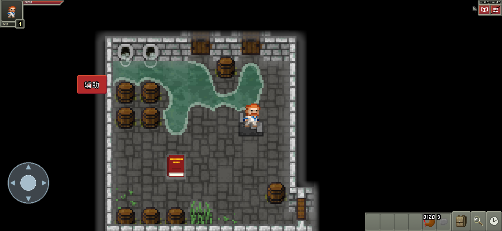
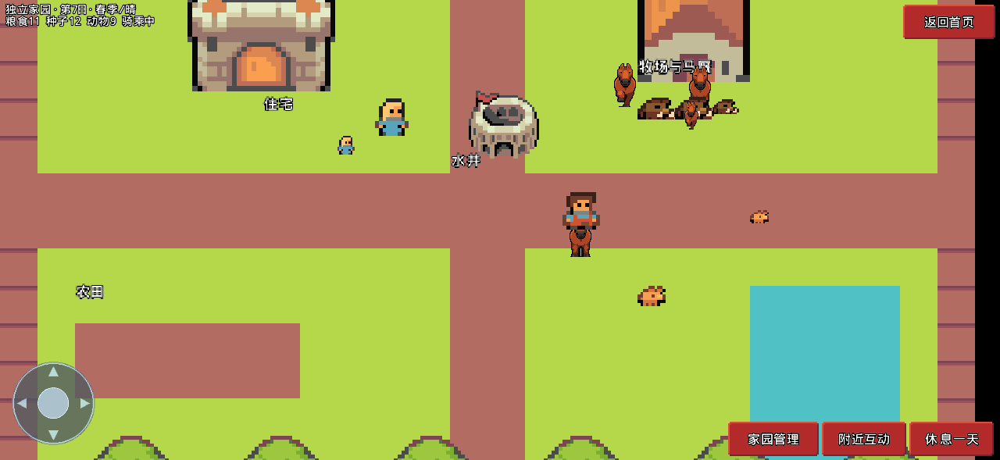
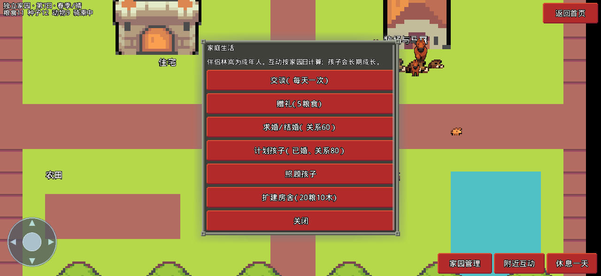

# Shattered Assist · 地牢与家园


基于 [Shattered Pixel Dungeon](https://github.com/00-Evan/shattered-pixel-dungeon) 4.0.2 的个人修改版，保留完整游戏和原作者署名，按 GPL-3.0-or-later 提供对应源码。不是原作者的官方发行版。

## 鸣谢原作者

感谢 **Evan Debenham（[00-Evan](https://github.com/00-Evan)）** 创作并持续维护 [Shattered Pixel Dungeon（破碎的像素地牢）](https://github.com/00-Evan/shattered-pixel-dungeon)，并以开源方式分享完整游戏。

感谢 **Oleg Dolya（[Watabou](https://watabou.itch.io/)）** 创作原版 [Pixel Dungeon](https://github.com/00-Evan/pixel-dungeon-gradle)，为本项目及其上游提供基础；同时感谢上游代码、美术、音效、翻译和其他贡献者，完整署名以游戏内鸣谢及上游记录为准。

家园人物、建筑、动物、马匹和挥砍素材感谢 **Pixel-boy / Sparklin Labs** 的 [Superpowers Asset Packs](https://github.com/SparklinLabs/superpowers-asset-packs)，采用 CC0-1.0。原始文件、固定提交和哈希详见 [素材来源](third_party/superpowers/manifest.json)，许可证随源码和游戏资源保留。用户提供的图标单独保存，不标注为该素材库作品。

本仓库仅在上游作品基础上增加个人辅助菜单、玩法选项和 iOS 构建配置，原游戏及原有素材的贡献归原作者和对应贡献者所有。本修改版由本仓库维护，与原作者的官方发行版独立，不代表原作者认可或背书。

原始项目说明见 [README_UPSTREAM.md](README_UPSTREAM.md)，许可证见 [LICENSE.txt](LICENSE.txt)。保留现有版权声明、游戏内鸣谢及许可证；本项目的修改按 **GPL-3.0-or-later** 提供。

## 最新更新：独立家园与中文触控

- **横屏手机适配**：完整安全区、角色与地图放大、界面大小调节、圆形八方向触控盘。
- **中文辅助 UI**：按钮可拖动、记住位置、隐藏，右上角游戏菜单保留恢复入口。
- **独立家园地图**：住宅、马厩、水井、12块农田、池塘与林地，可从首页或地牢菜单进入。
- **家庭生活**：成年伴侣交谈与赠礼、求婚结婚、计划孩子、照顾与长期成长、扩建房舍。
- **农牧生态循环**：马／鸡／兔三种动物，饲养、饮水、觅食、繁殖、幼崽成长、衰老；作物、雨水与四季影响资源。
- **坐骑**：家园骑乘动画，返回地牢后保留骑乘状态，地牢移动速度增加25%。
- **打击表现**：保留原战斗动画与判定，追加五帧像素挥砍特效。
- 使用你提供的图标作为 iOS 应用图标、启动画面和仓库展示图，原图保存在 docs/images。

家园规则与操作详见 [家园指南](docs/HOME_SYSTEM.md)，全部更新见 [CHANGELOG.md](CHANGELOG.md)。家园时间以点击“休息一天”推进，不使用真实时间；这是有明确规则的三物种生态模拟，不是现实生态模型。

### 实际桌面渲染验证（不是 iPhone 截图）





## 安装

构建成功后下载 [ShatteredAssist.ipa](packages/ShatteredAssist.ipa?raw=true)，导入轻松签，使用你自己的有效证书及描述文件签名后安装。无需额外授权码、巨魔、越狱或跨进程权限。证书有效性、设备登记、开发者模式等仍遵循你的签名方式要求。

目标设备：iPhone 16 Pro / iOS 27.0.1。云端编译成功不代表已在该设备实测，实际状态见 packages/build-info.json。

## 游戏内辅助

进入地牢，等到角色可操作时点击“辅助”按钮；按住拖动可移动，设置会记住位置。菜单中可隐藏按钮，隐藏后在右上角游戏菜单选择“辅助设置／恢复按钮”。左下角圆形方向盘可八方向移动、碰到敌人时按原游戏规则攻击，松手或切换窗口会停止。菜单只存在于本游戏内。

- 武器／徒手攻击倍率：1、2、5、10倍循环；倍率应用在伤害随机值计算后、敌人防御结算前，不包含法杖等独立伤害来源。
- 阻止生命伤害：阻止进入 Hero.damage 的正伤害，不承诺覆盖脚本直接死亡、剧情结算或生命上限变化。
- 免饥饿：清空饥饿累计并停止饥饿增长，关闭后恢复原有饥饿规则。
- 一键恢复生命：只对仍存活且当前可操作的角色恢复生命，不复活死者或消除异常状态。
- 关闭全部辅助：恢复1倍伤害，关闭免伤、免饥饿。

默认关闭，选项持久保存并影响后续对局。独立 bundle ID 与官方版区分；仍建议备份个人存档，不要修改为官方包名覆盖安装。

## 构建与验证

macOS + Xcode + JDK21：

```sh
./gradlew -PiosOnly :core:test
./gradlew -PiosOnly -Probovm.archs=arm64 -Probovm.iosSkipSigning=true :ios:createIPA
python3 tools/package_ios.py
```

GitHub Actions 自动执行上述流程，保存编译、测试和验包记录，并将 IPA 保存到 packages。未包含签名证书、密码或描述文件。

## 来源和修改

上游源码基线：57a4e06a4caf162446d1c28caa7983f0493fecf0。

新增 assist/AssistRules、AssistSettings、ui/AssistButton、windows/WndAssist；在 Hero、Hunger、GameScene 接入；更改应用名称和 bundle ID；保留原 Java 类包名供 RoboVM 正确启动。辅助菜单统一中文，iOS默认简体中文；横屏保留，角色默认放大，界面使用安全区内可容纳的最大尺寸。保留原游戏资源与署名，详情见 README_UPSTREAM.md 和 LICENSE.txt。

更新记录见 [CHANGELOG.md](CHANGELOG.md)，手机适配故障与验证见 [docs/MOBILE_CONTROLS.md](docs/MOBILE_CONTROLS.md)。
